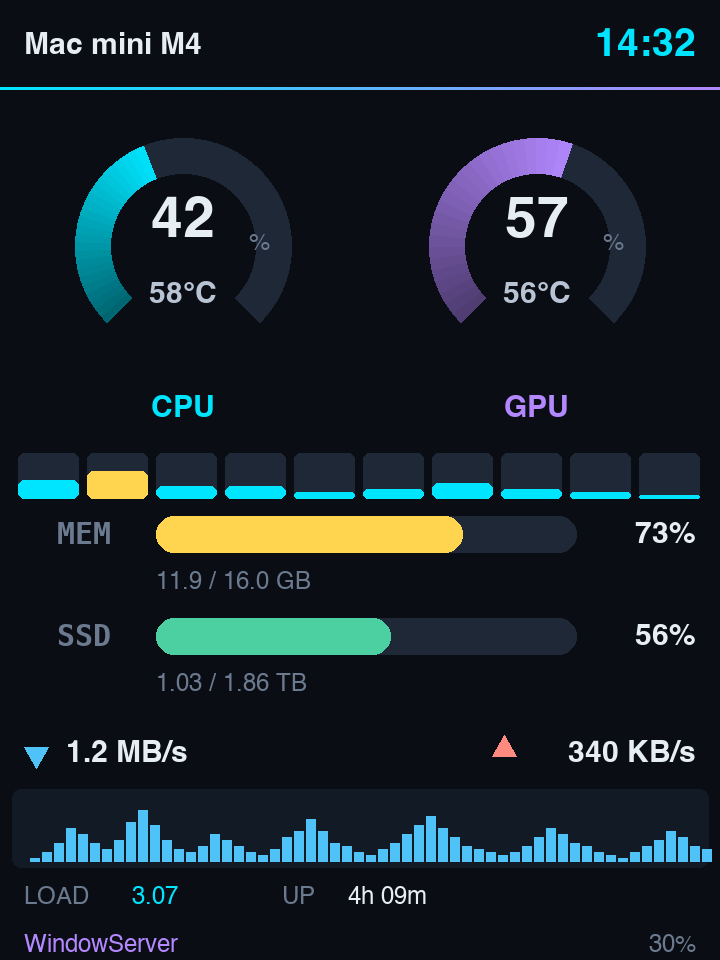
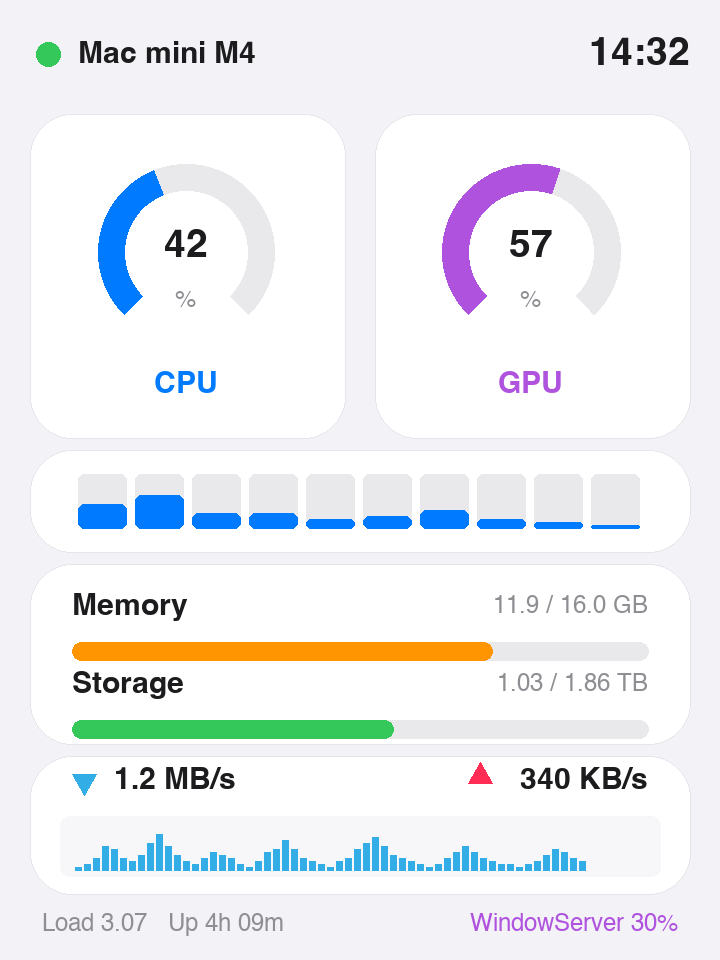
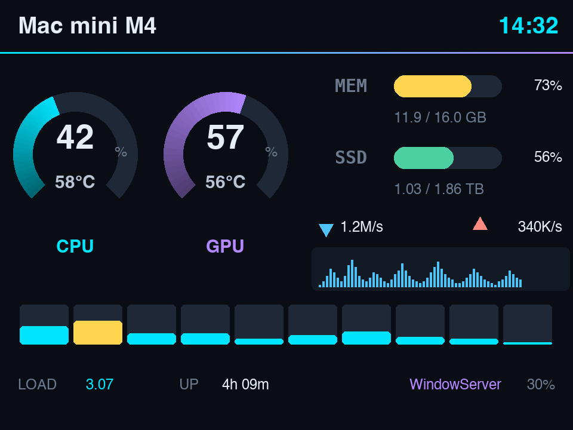

# Mac 监控屏 · ESP32-C3 + 2.4" ST7789

把 Mac 的实时状态显示在一块 2.4 寸彩屏上。Mac 侧跑一个后台采集进程，通过 USB 串口把数据推给 ESP32-C3，由它渲染仪表盘。

**监控项**：CPU / GPU 占用率与温度、每核负载、内存、存储、网络上下行速率与波形、Load average、开机时长、当前最占 CPU 的进程。

三套界面可随时切换：深色竖版、深色横版、浅色 Apple 风竖版。

## 界面

<p align="center">
  
  &nbsp;&nbsp;
  
</p>
<p align="center">
  
</p>

> 以上是按各固件源码里的**实际版式常量和配色**生成的示意图（[`docs/make_mockups.py`](docs/make_mockups.py)），**不是实拍照片**。改了版式重跑一次脚本就能同步。

---

## 硬件

| 部件 | 型号 |
|---|---|
| 主控 | 合宙 AirM2M **CORE ESP32-C3**（丝印 `CORE-ESP32_A12`），RISC-V，4MB flash |
| 屏幕 | 2.4 寸 **ST7789** 240×320，SPI |
| 载板 | 新瑞恒 2.4 寸屏载板，核心板直接焊在上面 |

### 引脚

核心板 1–32 焊盘编号 → GPIO。屏只用右半边（17–32）：

| 焊盘 | GPIO | 用途 |
|---|---|---|
| 17 | — | GND |
| 18 | — | 3.3V |
| 19 | GPIO2 | **SCK** |
| 20 | GPIO3 | **MOSI** |
| 23 | GPIO7 | **CS** |
| 27 | GPIO5 | **RST** |
| 28 | GPIO4 | **DC** |
| 32 | — | GND |

背光 **BL 不接 GPIO**，经载板 R2「背光亮度」电阻直接上电，亮度由阻值定死，软件不可调。

引脚定义集中在 [`include/display.h`](include/display.h)，三套固件共用。

---

## 快速开始

### 1. 环境

克隆后进入项目目录：

```bash
python3 -m venv .venv
.venv/bin/pip install platformio esptool pyserial psutil
```

> macOS 全新装机时 `/usr/bin/python3` 只是个占位符，首次调用会弹窗要求安装命令行工具。`install.sh` 开头已经检查了这一点，不满足会直接提示跑 `xcode-select --install`，而不是装到一半留个半吊子状态。

### 2. 烧录固件

```bash
./flash.sh land
```

| 参数 | 界面 |
|---|---|
| `monitor` | 深色科技风 竖版 240×320 |
| `land` | 深色科技风 横版 320×240 |
| `light` | 浅色 Apple 风 竖版 |

脚本会自动停掉采集端让出串口、烧录、再把采集端拉回来。**不要直接用 `pio run -t upload`**——采集端占着串口，esptool 抢不到。

### 3. 安装采集端（开机自启）

```bash
./mac_agent/install.sh
```

装到 `~/Library/Application Support/MacMonitor/`，自带 venv，和本工程目录解耦——工程移动或删除都不影响运行。注册为 LaunchAgent，开机自启（`RunAtLoad`）+ 崩溃自动重拉（`KeepAlive`）。

卸载：`./mac_agent/uninstall.sh`

---

## 日常操作

```bash
./mac_agent/ctl.sh status
```

| 命令 | 作用 |
|---|---|
| `status` | 服务状态 + 当前串口 + 最后一条日志 |
| `start` / `stop` / `restart` | 启停 |
| `log` | 跟踪日志 |
| `port` | 当前串口设备路径 |
| `label "文字"` | 临时预览一个机型名，按回车自动恢复 |

日志在 `~/Library/Logs/MacMonitor.log`，带时间戳。

---

## 工作原理

```
┌─────────────────────────┐         ┌──────────────────────┐
│ Mac                     │         │ ESP32-C3             │
│                         │  USB    │                      │
│ mac_monitor.py  ────────┼────────►│ 解析 → 渲染 → ST7789 │
│  psutil / ioreg / IOKit │ 串口2Hz │  LovyanGFX + 分区精灵│
└─────────────────────────┘         └──────────────────────┘
```

ESP32 自己拿不到 Mac 的数据，所以采集全在主机侧完成，屏幕只负责渲染。

### 数据来源

| 指标 | 来源 | 是否需要 sudo |
|---|---|---|
| CPU 占用 / 每核 | `psutil.cpu_percent(percpu=True)` | 否 |
| GPU 占用 | `ioreg -c IOAccelerator` 的 `Device Utilization %` | 否 |
| **CPU / GPU 温度** | IOKit `IOHIDEventSystemClient` 私有 API | **否**（见下） |
| 内存 / 存储 | `psutil` | 否 |
| 网络速率 | `psutil.net_io_counters()` 差分 | 否 |
| 最占 CPU 的进程 | `ps -Aceo pcpu,comm -r` | 否 |

### 通信协议

单行文本，`\n` 结尾，115200（USB CDC 实际不受波特率限制）。

```
$I,<机型标签>
$M,cpu,gpu,memPct,memUsedMB,memTotalMB,swapPct,diskPct,diskUsedGB,diskTotalGB,
   rxKBs,txKBs,load1,uptimeMin,HH:MM,topName,topCpu,cpuTempC,gpuTempC,ncore,c0..cN
```

`$M` 每 0.5 秒一条。`$I` 连上时发一次，之后每 10 秒补发——**ESP32 随时可能重启，重启后它只有等到下一条 `$I` 才知道自己接的是哪台机器**。

解析与平滑动画在 [`include/stats.h`](include/stats.h)，三套固件共用，保证协议只有一处定义。

---

## 温度是怎么拿到的

Apple Silicon 上温度不是拿来就有的：

- `powermetrics` 要 sudo，而且 **M4 上连 `smc` sampler 都被移除了**
- `ioreg` 看不到这些传感器（它们是 IOHIDEvent 服务，不在 IORegistry 属性里）
- LaunchAgent 里不可能有 sudo

最终走 IOKit 的 `IOHIDEventSystemClient` 私有 API（[`mac_agent/temps.py`](mac_agent/temps.py)），**免 root 读到 40 个传感器**。

麻烦在于 M3/M4 的传感器统一叫 `PMU tdie1..14`，**没有任何 CPU/GPU 标签**（M1/M2 才有 `pACC` / `eACC` / `GPU MTR Temp Sensor` 这种明确命名）。所以分区是实测标定出来的，不是猜的：

1. 分别把 CPU 和 GPU 各跑满 30 秒，记录每个传感器的温升
2. 各自除以本次测试的平均温升做**归一化**，消除「整块 die 一起热」的干扰
3. 比较两次的偏向

M4 实测结果：

| 分区 | 传感器 | 偏向系数 |
|---|---|---|
| CPU | `tdie1` / `tdie3` / `tdie8` | 1.29 / 1.42 / 1.66 |
| GPU | `tdie2` / `tdie5` / `tdie7` | 1.85 / 1.18 / 1.37 |

> **注意**：M4 的 CPU 和 GPU 在同一块 die 上，所以两个读数天然接近（空载时可能只差 1°C）。**这是物理现实不是 bug**，只有单独压 CPU 或单独压 GPU 时才会拉开差距。

换机器时：M1/M2 走显式命名（最可靠）；未标定的芯片退回「所有 die 传感器均值当 CPU、峰值当 GPU」。要为新芯片标定，按上面三步做，把结果加进 `temps.py` 的 `DIE_PROFILES`。

---

## 目录结构

```
platformio.ini          三套界面 + 四个诊断固件的构建配置
flash.sh                切换/烧录固件（自动让出串口）

include/
  display.h             引脚 + SPI 配置，所有固件共用
  stats.h               协议解析 + 动画平滑，所有固件共用

src/
  monitor/              深色科技风 竖版 240x320
  monitor_land/         深色科技风 横版 320x240
  monitor_light/        浅色 Apple 风 竖版
  scanner/  focus/      引脚探测固件（见下）
  pintest/  hello/      单点验证 / 最小诊断固件

mac_agent/
  mac_monitor.py        采集主程序
  temps.py              温度读取（IOKit 私有 API）
  install.sh            安装为 LaunchAgent
  uninstall.sh          卸载
  ctl.sh                日常控制
  decode_focus.py       把 focus 扫描的编号翻译回引脚定义
```

---

## ⚠️ 三条硬性约束

这三条是踩出来的，换板子/重装时**必须保留**，否则症状极难定位。

### 1. flash 必须 40MHz

```ini
board_build.f_flash = 40000000L
```

这块 EON 4MB flash **跑不了默认的 80MHz**。用 80MHz 烧**任何**固件，bootloader 都读不出 app，会 **13ms 一轮疯狂重启**。而且 panic 日志走 UART0，从 USB 完全看不到，串口上只有 ROM 的 `rst:0x3 (RTC_SW_SYS_RST)` 刷屏——非常容易误判成代码问题。

### 2. 屏幕 SPI 必须 20MHz

```c
#define SPI_WRITE_HZ 20000000
```

40MHz 下这块屏**完全不出图**。当初引脚已经猜对了却黑屏，就是栽在这里。

### 3. 打开串口会复位 ESP32

C3 的 USB-Serial-JTAG 用 DTR/RTS 控制复位，设 `dtr=False; rts=False` 也挡不住。两个后果：

- **设备上跑长任务时不要连串口去看进度**，一连就把它打回起点
- 复位会重新枚举 USB，**设备路径每次都变**（实测 `21201 → 212401 → 212101 → 1301`）。所以采集端按 VID `0x303A` 认设备，`platformio.ini` 也不写死 `upload_port`——任何写死路径的方案都撑不过一次复位

---

## 排障

先看这个，它把三件事一次说清：

```bash
./mac_agent/ctl.sh status
```

### 屏幕停在 "waiting for host"

说明固件在跑但收不到数据。按 `status` 的输出分两种：

- **`串口: (设备不在)`** → USB 数据链路没通。屏幕亮着只能说明供电正常，C3 的 USB-Serial-JTAG 是硬件外设，芯片一跑起来 ROM 阶段就该枚举。**重插 USB-C 线**（优先直插 Mac，绕开扩展坞）；仍然不认就换根线——**有些 USB-C 线只有供电没有数据线芯**，症状就是板子亮、电脑永远看不见。
- **`服务: 未运行`** → `./mac_agent/ctl.sh start`

### 日志里刷 `Write timeout`

写超时 ≠ 掉线，它只说明 ESP32 一时没把 CDC 缓冲读走（典型场景：刚被复位，正在跑 `lcd.init()` 和分配精灵）。

采集端**不会**因此重连——重连会再复位一次设备，让对方更来不及读，形成「连上→超时→重连→复位」的死循环。现在是丢帧继续，连续 8 次才判定真挂死。

### 日志里刷 `Device not configured`

设备真的掉了（通常是 C3 复位后重新枚举，旧 fd 失效）。采集端 2 秒内自动重连，属于预期内的自愈。

### 服务莫名其妙没了

一个 label 被 `bootout` 过之后，launchd 会把它记进 **disabled 列表**，之后光靠 `bootstrap` 是拉不起来的，而且**静默失败**。`ctl.sh start` 和 `install.sh` 都已经先执行 `launchctl enable` 再 bootstrap。

---

## 换一块新屏怎么找引脚

如果换了载板不知道接线，`src/` 下留了完整的探测工具链：

| 固件 | 用途 |
|---|---|
| `hello` | 最小固件，只打印心跳。**先跑这个**确认板子能正常启动（当初就是靠它定位到 flash 频率问题） |
| `scanner` | 全盘扫描。12 个候选 GPIO 的全排列，约 11905 种组合 |
| `focus` | 聚焦扫描。已知只用某几个 GPIO 时用，372 种组合约 75 秒跑完 |
| `pintest` | 二选一验证，用于最后确定 DC/RST 谁是谁 |

原理：把没参与的候选脚全部输出高电平（释放 RST、点亮 BL），然后依次假设各引脚角色，每种组合刷一个大编号上屏。**猜错 SCK 时真正的时钟线是静止高电平，屏幕收不到任何信号**，所以只有唯一正确的组合能画上去；而 ST7789 自带显存，画上去的编号会一直 latch 住不被擦掉。看到数字报回来，用 `decode_focus.py <编号>` 就能反查出完整引脚定义。

```bash
.venv/bin/python mac_agent/decode_focus.py 13
```

---

## 适用范围与限制

- **仅 macOS**。采集端依赖 `ioreg`、`system_profiler`、IOKit 私有 API，这些都是 macOS 专有的。
- **温度分区目前只标定了 Apple M4**。M1/M2 走显式传感器命名可直接用；其它芯片会退回「均值当 CPU、峰值当 GPU」的粗略估计，按上文方法标定后加进 `DIE_PROFILES` 即可。
- **引脚映射对应文中那块载板**。换板子请用 `scanner` / `focus` 探测固件重新确定，不要照抄。
- Intel Mac 未实测。CPU/内存/存储/网络应该正常，GPU 占用和温度取决于机型。

欢迎提 issue 补充其它芯片的标定结果和载板引脚定义。

---

## License

[MIT](LICENSE)
